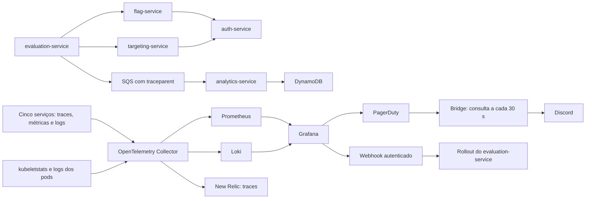

# Fase 4 — preparação sem AWS Academy

Estado em 12/11/2026: os cinco serviços e a stack de observabilidade foram compilados/iniciados no Docker local. Avaliação, gravação no DynamoDB, ingestão de métricas/logs e provisionamento do Grafana foram verificados por API. Implantação no EKS, integrações externas e evidências acadêmicas finais continuam pendentes. Nenhum recurso AWS foi criado ou alterado nesta etapa. As mudanças ainda não foram publicadas no GitHub.

## O que está preparado

| Entrega | Situação |
|---|---|
| OpenTelemetry nos cinco serviços | Código implementado; exportação HTTP/protobuf dos três sinais validada nos dois contextos Go e três Python |
| Propagação entre serviços e fila | HTTP concorrente, cliente Python e atributos W3C da mensagem SQS testados localmente |
| Collector central | Configuração executada com o binário oficial 0.165.0 e destinos locais de teste |
| Prometheus, Loki e Grafana | Containers iniciados; datasources saudáveis, dashboard com oito painéis e alerta conferidos por API; inspeção visual final pendente |
| Infraestrutura Kubernetes | DaemonSet de métricas/logs, RBAC e overlays renderizados; kubelet, certificados, permissões e armazenamento dependem do cluster |
| New Relic | Conta US e chave configuradas; trace dos cinco serviços, fila e DynamoDB Local confirmado: 13 spans, 18,58 ms e zero erros; mapa dos cinco serviços confirmado e captura preservada |
| Incidentes e Discord | Fluxo real Grafana → PagerDuty → bridge → Discord validado no Compose: incidente aberto e resolvido, com duas notificações entregues |
| Self-healing | Webhook autenticado e reinício restrito a um Deployment; testes locais aprovados; recuperação real em Kubernetes pendente |
| Entrega acadêmica | Roteiro e estrutura do relatório preparados; gravação e capturas exigem execução real |

Em 08/11, o Docker Desktop falhou por um socket temporário inacessível. Em 12/11, uma nova inicialização fora do sandbox funcionou: Engine 29.4.0 e WSL 2 disponíveis. Não foi necessário reset de fábrica, exclusão de volumes ou remoção de distribuições. O bloqueio do ensaio local foi superado.

## Arquitetura



O bridge consulta apenas um serviço do PagerDuty e envia mudanças de estado ao Discord. Não exige endpoint público para receber webhooks. O token REST do PagerDuty deve ser de leitura; a chave de integração Events API v2 é outra credencial. A entrega é pelo menos uma vez: uma interrupção entre envio e gravação do estado pode duplicar a mensagem. A janela de consulta é de 24 horas, adequada ao ensaio; não é um coletor histórico de incidentes.

Os traces atravessam HTTP e SQS. Em cache hit, a avaliação não chama flag/targeting/auth; procure um trace de cache miss para demonstrar os cinco serviços. O serviço analytics processa eventos, portanto não gera volume HTTP de negócio além do health check, que é excluído da instrumentação.

## Validações realizadas

- `go test ./...` e `go vet ./...` em auth e evaluation: exportação OTLP dos três sinais, preservação de trace HTTP, cancelamento e mensagem SQS.
- Teste Python em cada build context: Flask, cliente HTTP, contexto da fila, métricas e logs correlacionados.
- Onze casos de automação: autenticação, payload inválido, evento resolvido, alvo incorreto, deduplicação persistida, cooldown, evento antigo, repetição após erro e transições/retentativa do Discord. O novo caso verifica a recuperação por webhooks repetidos após falha temporária da API Kubernetes.
- Nove cenários de alerta executados com Prometheus/promtool 3.16.0: tráfego saudável, limiar exato, erro abaixo do limiar, volume insuficiente, duração pendente, recuperação, reset do contador, ausência de tráfego e isolamento do serviço. As sete consultas PromQL do dashboard também foram analisadas.
- Collector real: nomes das métricas usados pelo dashboard, status HTTP como rótulo, encaminhamento `/otlp/v1/logs` e remoção de query strings dos spans.
- Helm lint/render com integrações desativadas e ativadas; YAML interno e JSON do dashboard; cinco Deployments com ambiente OTEL; RBAC de remediação restrito.
- Compose config, Ruff e Bandit. O workflow `observability.yml` repete as validações sem credenciais AWS; os workflows existentes mantêm lint/SAST/SCA e scan de imagem. Esses jobs remotos ainda precisam rodar.

O teste automatizado do Collector usa um destino OTLP local que simula a ingestão de Loki/New Relic. Ele comprova o caminho e o conteúdo enviado, mas não substitui a validação desses produtos. Separadamente, em 13/11, foi confirmado envio real ao endpoint US e reconhecimento dos cinco serviços no painel New Relic; em 15/11, as capturas confirmaram um trace com os cinco serviços, fila e DynamoDB Local (ver VALIDACAO.md). O `validate` do node-agent precisa do certificado de ServiceAccount existente no cluster; sua inicialização autenticada não foi validada no Windows.

Para repetir os testes Python, instale os requirements de um serviço e `pytest==9.2.0 pyyaml==6.0.3`. Execute cada contexto em um processo separado, pois os providers OpenTelemetry são globais:

```powershell
$env:SERVICE_DIRECTORY='flag-service/flag-service-main'
python -m pytest tests/test_python_telemetry.py -q
# Repetir com targeting-service/targeting-service-main e analytics-service/analytics-service-main.
python -m pytest tests/test_incident_automation.py -q
$env:COLLECTOR_BINARY='CAMINHO_ABSOLUTO_DO_OTELCOL_CONTRIB'
python -m pytest tests/test_collector_contract.py -q
```

## Executar o ensaio local

Todos os comandos seguintes partem da raiz do repositório. O inicializador gera credenciais locais e preserva um arquivo existente; não imprime os valores:

```powershell
python observability/scripts/init_local_env.py
docker --context desktop-linux compose --env-file observability/.env -p fiap-observability -f observability/local/compose.yaml up -d
docker --context desktop-linux compose -f docker-compose.yml -f observability/local/apps.override.yaml up -d --build
$env:DOCKER_CONTEXT='desktop-linux'
python observability/scripts/prepare_local_demo.py
python observability/scripts/generate_load.py --seconds 240
```

`prepare_local_demo.py` registra somente o hash da chave do Compose no Postgres local, cria a flag/regra sintética `phase4-demo` e confere uma avaliação. Não imprime credenciais. Foi executado com sucesso em 12/11.

Abra `http://localhost:3000`, usuário `admin`, senha no campo `GF_SECURITY_ADMIN_PASSWORD` de `observability/.env`. O dashboard `ToggleMaster | Fase 4` apresenta volume, erros, p95 e logs. CPU/memória dos pods exigem o node-agent Kubernetes; esses painéis ficam sem dados no Compose. Para logs em fluxo contínuo, use Explore → Loki → Live; o painel do dashboard atualiza a cada 10 segundos. Sem o override APM, os traces vão para debug. A sessão local atual usa também `-f observability/local/apm.override.yaml`, enviando traces ao New Relic com a chave local. Preserve esse override ao reiniciar a stack.

O gerador inicia requisições sem `traceparent` por padrão, permitindo que o serviço crie o span raiz. `--remote-parent` serve apenas para testar propagação: injeta um pai não exportado e, portanto, produz um trace incompleto.

O Compose não notifica serviços externos. Para testar apenas o alerta, mantenha carga com `--allow-errors` e crie a falha em outro terminal:

```powershell
docker compose -f docker-compose.yml -f observability/local/apps.override.yaml exec evaluation-service touch /tmp/togglemaster-fault
```

O endpoint de avaliação retorna 503 enquanto o arquivo existir e `ENABLE_FAULT_INJECTION=true`. O health check continua saudável, permitindo que o alerta e o runbook sejam os responsáveis pela demonstração. O limiar é mais de 5% de respostas 5xx por 1 minuto, janela de 2 minutos e pelo menos 20 requisições nessa janela.

Para encerrar a falha local, remova o arquivo com `exec evaluation-service rm /tmp/togglemaster-fault` usando os mesmos argumentos Compose. O reinício de um container Docker preserva sua camada gravável; para simular a substituição do pod, use `up -d --force-recreate evaluation-service`. A automação Kubernetes não é executada pelo Compose.

O ciclo real foi verificado em 12/11: 503 → pending → firing → remoção manual → 200 → inactive. Veja [VALIDACAO.md](VALIDACAO.md) e seus registros JSON. Para repetir de forma controlada, mantenha o gerador de carga por oito minutos com `--allow-errors` e execute em outro terminal:

```powershell
python observability/scripts/exercise_local_alert.py --output tmp/phase4-alert-cycle.json
python observability/scripts/verify_local_stack.py --output tmp/phase4-stack-after-recovery.json
```

O script remove a falha no encerramento, inclusive se a verificação falhar. Ele identifica a recuperação como manual/local; o runbook Kubernetes continua sendo validado separadamente.

## Ensaio local com notificações externas

O override `local/incidents.override.yaml` é opcional e só deve ser ativado para um ensaio autorizado. Ele inclui a rota PagerDuty do alerta EvaluationHighErrorRate e o mesmo bridge utilizado no Kubernetes. A chave fica em variável de ambiente e nunca no YAML. O título do incidente identifica explicitamente o teste local. Preserve também o override APM ao executar Compose:

```powershell
docker --context desktop-linux compose --env-file observability/.env -p fiap-observability -f observability/local/compose.yaml -f observability/local/apm.override.yaml -f observability/local/incidents.override.yaml up -d grafana discord-bridge
```

Para acompanhar o PagerDuty sem enviar eventos, inicie `verify_incident_cycle.py --output <arquivo.json>` antes de injetar a falha. Execute a carga com `--allow-errors` e o roteiro `exercise_local_alert.py` em processos separados. A resolução do alerta não comprova entrega ao Discord: confira também os registros `discord_notified` do bridge.

Ao terminar, pare `discord-bridge` usando o mesmo conjunto de arquivos Compose e recrie Grafana com apenas compose.yaml e apm.override.yaml. O estado de deduplicação fica preservado no volume discord-state. Esse ensaio remove manualmente o arquivo de falha; não demonstra self-healing Kubernetes.

## Preparação de contas, sem AWS

O passo a passo atualizado está em [CONTAS.md](CONTAS.md). O verificador `python observability/scripts/check_readiness.py --integrations` informa campos pendentes sem mostrar credenciais.

1. New Relic: conta US e ingest license key já configuradas localmente. Trace e mapa dos cinco serviços confirmados no ambiente local; capturas preservadas. Não é necessária infraestrutura AWS para isso.
2. PagerDuty: criar um serviço para a avaliação, integração Events API v2, política de escalonamento e token REST de leitura. Anotar separadamente integration/routing key e service ID. Verificar no plano escolhido a disponibilidade dessas funções.
3. Discord: criar um canal do trabalho e um webhook para esse canal. O projeto usa o Discord já informado pelo usuário.
4. Copiar `secrets.env.example` para `.env` **dentro de observability**, preencher localmente e manter fora do Git. Gerar `RUNBOOK_TOKEN` aleatório com pelo menos 32 caracteres.

O usuário criou a conta New Relic; os traces sintéticos locais já são enviados ao endpoint US. Em 15/11, o teste autorizado abriu e resolveu um incidente PagerDuty e entregou as duas notificações no Discord (ver VALIDACAO.md). Não iniciar trials curtos muito antes do ensaio final.

## Momento de ativar o AWS Academy

Ative quando for publicar imagens, conferir a infraestrutura existente, implantar no EKS e coletar as evidências. Até lá, não é necessário consumir tempo de sessão.

Sequência prevista para a sessão:

1. Atualizar as credenciais temporárias fora do Git; conferir conta, região e contexto Kubernetes. Reutilizar `LabRole` e as políticas permitidas pelo Academy. Não criar/alterar roles IAM.
2. Validar as fases anteriores e dimensionamento dos nós. Conferir `StorageClass`/CSI antes de ativar persistência. O padrão usa `emptyDir`: logs, métricas e deduplicação podem ser perdidos quando os pods são substituídos.
3. Executar os pipelines existentes, publicar as cinco imagens e confirmar os novos digests. Os manifests base ainda apontam para imagens da fase anterior; aplicar somente variáveis OTEL não atualiza os binários.
4. Criar namespace `observability` e Secret `observability-secrets` com o arquivo local de ambiente. Exemplo para uso **somente após confirmar o contexto do laboratório**:

   ```powershell
   kubectl create namespace observability --dry-run=client -o yaml | kubectl apply -f -
   kubectl -n observability create secret generic observability-secrets --from-env-file=observability/.env --dry-run=client -o yaml | kubectl apply -f -
   ```

5. Publicar configurações revisadas e aplicar `gitops/argocd/observability-application.yaml`. O ArgoCD renderiza o chart Helm; o primeiro sync é manual. Integrar `values-lab.example.yaml` em `helm.valueFiles` quando chaves e contas estiverem prontas. Os defaults mantêm APM, notificações e self-healing desligados.
6. Reaplicar a definição `gitops/argocd/togglemaster-application.yaml`: o caminho preparado agora é `observability/apps`. A anotação específica de recuperação foi incluída em `ignoreDifferences` e `RespectIgnoreDifferences`; o restante continua sob controle do GitOps.
7. Para o ensaio de falha, mudar temporariamente esse caminho para `observability/lab-demo` pelo Git. Confirmar no pod a flag de injeção; voltar a `observability/apps` ao terminar.
8. Conferir ingestão no Prometheus/Loki/APM, métricas de CPU/memória e saúde do node-agent. O certificado kubelet é verificado por padrão; investigar CA/SAN se falhar. A opção de verificação insegura é excepcional e precisa ser documentada caso usada no laboratório.
9. Gerar carga, localizar um trace de cache miss e conferir o mapa de dependências no APM. Não considerar o mapa de cinco serviços concluído antes de vê-lo na ferramenta.
10. Injetar a falha no pod evaluation com `kubectl exec`, acompanhar alerta, incidente, Discord, log `restart_requested`, substituição do pod e retorno a HTTP 200. `restart-requested` significa que a API aceitou o PATCH; a conclusão é conferida com `kubectl rollout status` e nova avaliação.

O runbook possui somente `get/patch` no Deployment nomeado; não executa comandos recebidos no payload. O primeiro alerta dispara a ação, repetições são deduplicadas em SQLite e novas ações respeitam um mínimo de 300 segundos. A rota de self-healing repete a cada minuto, permitindo nova tentativa após o cooldown caso a primeira falhe; eventos já concluídos não reiniciam novamente. O Secret do Grafana/runbook e a persistência precisam ser verificados antes do ensaio. A primeira sessão também deve validar o tempo de resolução do alerta após a janela móvel de métricas.

## Referências técnicas

- [OpenTelemetry Go](https://opentelemetry.io/docs/languages/go/exporters/) e [Python](https://opentelemetry.io/docs/languages/python/exporters/).
- [Collector kubeletstats](https://github.com/open-telemetry/opentelemetry-collector-contrib/tree/main/receiver/kubeletstatsreceiver).
- [Ingestão OTLP no Loki](https://grafana.com/docs/loki/latest/send-data/otel/) e [provisionamento de alertas Grafana](https://grafana.com/docs/grafana/latest/alerting/set-up/provision-alerting-resources/file-provisioning/).
- [New Relic via OTLP](https://docs.newrelic.com/docs/opentelemetry/best-practices/opentelemetry-otlp/).
- [PagerDuty: listar incidentes](https://docs.pagerduty.com/developer/api/reference/rest/incidents/list-incidents).
- [Opsgenie: ciclo de vida](https://www.atlassian.com/licensing/opsgenie). PagerDuty foi escolhido para evitar dependência de novo cadastro em Opsgenie.

O [roteiro de evidências](EVIDENCIAS.md) separa as capturas reais necessárias do material já preparado.
